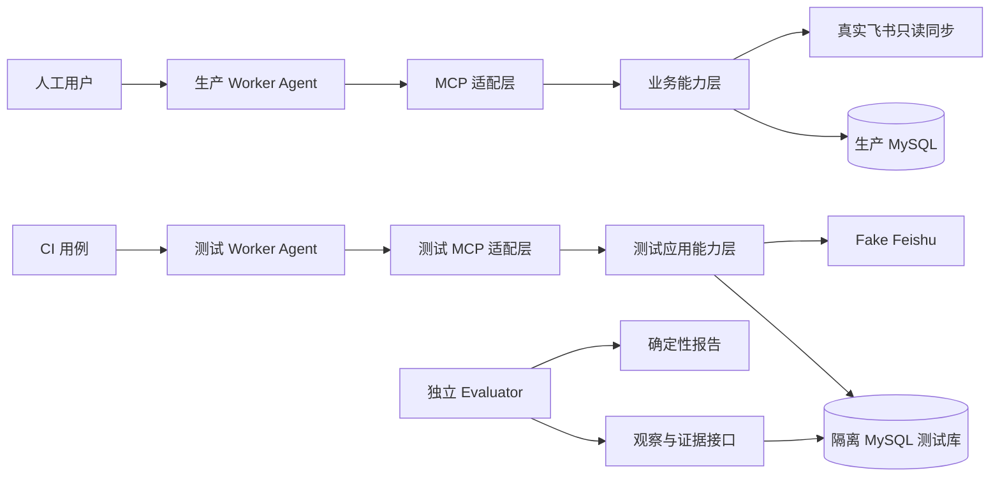
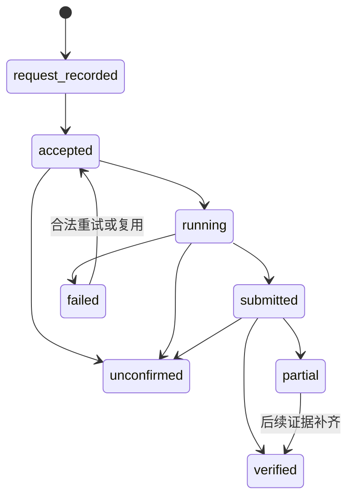

# Agent Native、MCP 与 Evaluation 对话归档

| 项目 | 内容 |
|---|---|
| 文档状态 | 本轮对话总结与实施进度归档 |
| 最后更新 | 2026-10-16（Asia/Shanghai） |
| 适用范围 | 组织架构维护系统的 Agent 能力、观察层、MCP 适配、Evaluation 与 CI |
| 需求原始归档 | `docs/architecture/agent-native-requirements-clarification.md` |
| 产品版本基线 | `v2.8.62` |
| 代码状态 | 实施工作位于独立分支；尚未合并、推送或发布 |

## 1. 这次讨论形成的核心认识

最初的问题是是否应该先构建 MCP、再收集用例、最后让 AI 执行用例。讨论确认的更准确顺序是：

```text
业务能力设计
  -> 可观察性设计
  -> 独立 MCP 适配
  -> 版本化 Evaluation 用例
  -> Worker Agent 执行
  -> 独立 Evaluator 判定
  -> CI 门禁与持续修复
```

MCP 只解决 Agent 如何调用系统，不能单独证明业务操作正确。系统必须先拥有稳定的业务能力、版本语义、审计和观察结果；Evaluation 才能依据独立事实判断 Worker 是否完成目标。

最终采用的设计原则是：

```text
Capability First
      +
Observability First
      +
Evaluation First
```

## 2. 已确认的需求与边界

### 2.1 用户已经确认的决策

| 主题 | 已确认内容 |
|---|---|
| 首期 Agent 范围 | 只读、门店操作、同步操作 |
| 服务对象 | 人工对话和 CI 都支持 |
| 写操作 | 采用分级控制 |
| 生产写权限 | 人工 Agent 可在策略允许且确认后写生产 |
| CI 写权限 | CI 只能写隔离环境，不能写生产 |
| MCP 架构 | 业务能力层 + 独立 MCP 适配层 |
| 测试环境 | MySQL 测试库 + Fake Feishu |
| Evaluator 依据 | 确定性断言为主，LLM 仅辅助 |
| 下一步方式 | 先形成详细设计，再实施 |
| 执行方式 | Subagent-Driven：按任务派生、逐任务复核、最后统一验收 |

### 2.2 明确排除的能力

- MCP 不直接访问数据库，也不复制业务逻辑。
- 首期不通过 Agent 创建、移动或删除飞书组织事实。
- 不提供任意 SQL、数据库管理、迁移执行或生产凭据工具。
- 不让 Worker 自报结果成为最终验收依据。
- 不把 HTTP 200、任务 `succeeded` 或模型文本单独解释为业务完成。
- 不把真实生产数据库、企业飞书或真实模型调用接入普通 CI。

## 3. 目标架构



分层职责如下：

| 层 | 职责 | 不负责的事情 |
|---|---|---|
| 业务能力层 | 查询、门店修改、同步任务、版本校验、事务和审计 | MCP 协议细节、模型提示词 |
| 观察层 | 返回执行状态、事实质量、版本、任务、审计和后置证据 | 替 Evaluator 直接下结论 |
| MCP 适配层 | 工具 schema、身份、权限、确认、追踪、错误映射 | 绕过能力层直接改库 |
| Worker Agent | 理解目标并调用允许的工具 | 读取期望状态、直接查库、自报验收 |
| Evaluator | 只读独立证据、确定性断言、报告和评分 | 使用 Worker 自报结果制造期望 |
| CI | 隔离运行、收集报告、阻断确定性失败 | 写生产或连接真实企业服务 |

## 4. 能力与观察结论

### 4.1 能力契约

首期能力分为三类：

1. **查询与观察**：系统状态、部门、员工、门店、门店员工、变更日志、同步任务和操作回执。
2. **预览与影响分析**：校验门店变更、计算影响范围，不产生业务副作用。
3. **受控写入**：应用门店变更、发起同步、重试同步；生产写操作需要人工确认，CI 测试身份可在隔离环境自动执行。

权限等级保持为：

| 等级 | 示例 | 生产人工 Agent | CI Worker |
|---|---|---|---|
| L0 | 查询、观察、读取日志 | 自动 | 自动 |
| L1 | 预览、影响分析 | 自动 | 自动 |
| L2 | 应用门店变更、范围受限同步 | 确认后执行 | 隔离环境自动执行 |
| L3 | 凭据、管理员、任意组织写入 | 禁止 | 禁止 |

### 4.2 观察结果必须拆开表达

观察结果至少区分以下维度：

| 维度 | 说明 |
|---|---|
| `execution` | 请求是否记录、任务是否接收、是否执行、是否提交、是否失败、是否未确认 |
| `fact_quality` | 已解决、部分解决、未知、不一致或不适用 |
| `operation` | `operation_id`、能力、身份、运行和用例关联 |
| `job` | 任务类型、范围、阶段、终态、进度和错误 |
| `dataset` | `dataset_epoch`、`data_version`、覆盖状态 |
| `evidence` | 目标对象、影响对象、提交版本、变更日志和后置条件 |
| `next_action` | 继续观察、重新读取、人工确认、重试或等待外部修复 |

操作状态的成功层级为：



关键口径：

- `submitted` 只表示业务提交事务结束；`verified` 才表示独立后置条件已满足。
- 等待或连接超时进入 `unconfirmed`，不能自动补发同一个写请求。
- `pending_verification`、`unknown` 和 `inconsistent` 不能被解释为删除、离职或空结果。
- “主部门不在门店下”和“主部门不可读”分别返回 `not_in_store` 与 `unknown`。
- 业务查询必须绑定同一世代和版本；版本变化返回 409，调用方先重新读取。

## 5. MCP 与安全边界结论

实施讨论确认了独立 MCP 适配层的以下约束：

- 使用官方 MCP SDK，工具 schema 严格校验输入，拒绝额外字段、隐式布尔值和非法游标。
- MCP token 与后端能力服务 token 分离；CI、人工生产和测试环境使用不同身份与环境标识。
- 身份由受信配置注入，客户端不能通过请求参数自行提升 `actor`、环境或确认状态。
- 生产 L2 写工具必须经过客户端确认；拒绝、取消、超时和不支持的确认都不产生 HTTP 写入。
- 请求、响应和错误追踪只保留有限元数据；密码、token、URL 用户信息、原始人员敏感字段和未知对象不得进入日志。
- 写请求超时必须先通过操作回执、任务和版本观察结果确认，不能直接重提。
- 使用固定内部能力前缀、禁止重定向、固定超时和受控错误字段，避免路径穿越、凭据转发和错误信息泄漏。

## 6. Evaluation 设计结论

### 6.1 用例结构

每个用例版本化保存以下内容：

| 字段 | 含义 |
|---|---|
| `case_id` | 稳定标识 |
| `goal` | Worker 可见的自然语言目标 |
| `fixture` | MySQL 初始数据和 Fake Feishu 场景 |
| `allowed_tools` | 工具白名单和预算 |
| `expected_state` | Evaluator 使用的目标事实 |
| `forbidden_effects` | 禁止的副作用 |
| `timeout_seconds` / `max_tool_calls` | 时间和调用上限 |
| `trace` / `evidence` | 过程轨迹和独立证据 |

Worker 只能看到目标和允许工具，不能看到 `expected_state`、`forbidden_effects`、数据库连接、Fake Feishu 控制面或断言对象。

### 6.2 首批用例

首批用例覆盖：

1. 员工主门店解释：主部门、多个门店、`not_in_store` 和 `unknown` 不混淆。
2. 门店资料维护：预览、确认、提交版本、投影和审计一致。
3. 子树同步：范围、任务终态、重复事件和部分不可读事实。
4. 版本冲突恢复：409 后重新读取，不覆盖新版本。
5. 权限收窄保护：不可见对象保留旧事实并降低事实质量，不能误报删除。
6. Agent 权限边界：只读身份不能写入，敏感信息不进入结果或日志。

### 6.3 Evaluator 判定

硬门槛由独立只读证据决定，包含：

- 目标业务事实；
- 版本、世代和事务一致性；
- 任务终态和操作回执；
- 审计链与目标对象绑定；
- 工具白名单、调用次数、时间和顺序；
- 禁止副作用、权限边界和敏感信息泄漏。

软评分只描述意图理解、工具选择、证据说明、歧义处理和效率。LLM Judge 默认关闭，不参与 CI 硬门禁；如启用，必须显式指定模型、数据外发策略和脱敏规则。

## 7. 当前实施进度

以下状态来自本轮对话中已完成的实施任务和独立复核记录。它们均位于独立实施分支，尚未合并到当前工作区的主分支。

### 7.1 已完成并复核的部分

- **Capability / Observation**：完成能力契约、不可变上下文与观察结果、操作回执、版本与幂等约束、门店服务事务集成、内部 HTTP 路由和实际 MySQL 验收。
- **MCP 适配**：完成官方 SDK 入口、身份与权限策略、追踪脱敏、内部 HTTP 客户端、实际 MCP 工具、确认流程、传输安全边界、运行配置和健康探针。
- **Evaluation Task 1**：完成严格版本化 YAML 用例 schema、只读主门店用例、预算和工具目录校验。
- **Evaluation Task 2**：完成 Fake Feishu 采集接口、场景预设、实际 MySQL 测试库隔离、迁移和租约静默检查、按用例重置。
- **Evaluation Task 3**：完成独立只读证据、私有快照、硬断言和隐私安全检查；后续修复了“空轨迹也可能被当成成功”和“审计未绑定目标对象”两个问题，并通过独立复核。

### 7.2 当前正在推进的部分

- **Evaluation Task 4 Runner / Harness** 已开始实现，已跑通两个正式只读用例的真实链路：官方 MCP 客户端 → 真实 MCP Server → `CapabilityHttpClient` → 实际 ASGI 内部路由与鉴权 → MySQL。
- 每个只读用例结束后已验证 22 张业务表回到安全基线，避免用例之间互相污染。
- 写操作链路测试发现一个断言问题：合法的“读取版本 v1 → 写入版本 v2 → 最终读取版本 v2”不能因为早期读取版本不同而失败。当前修正方向是按末次相关目标读取判定最终完成，同时保留所有过程证据，并确保晚失败不能被早期成功掩盖。
- Task 4 的超时、并发隔离、Worker 自报结果抵抗、租约释放以及生产同步写链路仍需完成双重评审。

### 7.3 尚未完成的部分

- Evaluation Task 4 的最终提交、复核和整体验收尚未完成。
- Evaluation Task 5 的门店写入、同步子树、版本冲突和权限收窄用例尚未完成最终验收。
- Evaluation Task 6 的软评分、报告、CI 入口、接受记录和 ADR 0002 尚未完成最终验收。
- 三个实施计划尚未进行最终统一的全分支评审、修复波次和范围复核。
- 尚未形成最终交付报告；当前交付目录和实现分支仍需由实施流程完成收束。

## 8. 已验证与未验证的边界

### 已验证范围

- 实际本地 MySQL 8.4 测试库、真实迁移和实际会话字符集 / 隔离级别。
- 能力层、观察层、内部 HTTP 鉴权、官方 MCP SDK、真实 MCP Server / Client 链路。
- Fake Feishu 读取、分页、权限收窄、超时和场景隔离。
- 独立只读证据、版本一致性、审计绑定、敏感信息脱敏和测试库清理。

### 尚未验证范围

- 企业真实飞书权限、OAuth、事件长连接和真实生产数据。
- 真实外部 LLM 调用及 LLM Judge 的稳定性、成本和数据外发合规性。
- Docker 容器构建、跨容器网络、DNS 和生产部署环境。
- 生产灰度、生产人工确认入口、回滚演练和扩大 Agent 写权限。
- 代码分支合并、远端推送、PR 和产品版本发布。

## 9. 当前故障与排障口径

| 现象 | 当前解释 | 处理方式 |
|---|---|---|
| 有任务但未验证 | 业务提交可能已经完成，独立后置条件尚未满足 | 读取操作回执、任务、版本和目标事实 |
| 写请求超时 | 结果未确认，不能据此判断失败 | 按 `operation_id` / 幂等键查询，不重提 |
| 版本冲突 | 读取基线已过期 | 重新读取世代和版本后再预览或提交 |
| 事实质量为 `unknown` | 来源或祖先不可读 | 保留已知事实，等待权限或重新同步 |
| Evaluator 与 Worker 结论不同 | Worker 自报不能覆盖独立证据 | 以独立 Evaluator 结论为准，保留轨迹 |
| 用例后表未回到基线 | 测试隔离失效 | 立即停止后续用例，检查独立连接、租约和清理事务 |

## 10. 后续实施顺序

1. 完成 Task 4 的断言修正、运行时隔离、超时和真实写链路，并完成实现与质量双评审。
2. 完成 Task 5 的剩余 Evaluation 用例和 CLI / CI 安全边界。
3. 完成 Task 6 的报告、软评分、验收记录和 ADR 0002。
4. 对三个计划合并后的完整分支做一次最强能力最终评审，再进行一次统一修复波次和范围复核。
5. 读取最终交付报告，确认工作区干净后再决定是否保留分支、合并或创建 PR；当前未授权推送、合并或发布。
6. 真实飞书、真实模型、Docker 和生产灰度另行验收，不能由本地测试结论替代。

## 11. 与现有文档的关系

- `docs/architecture/agent-native-requirements-clarification.md`：保留原始需求澄清、方案和实施阶段设计，本文件补充当前对话后的实施进度。
- `docs/adr/0001-product-version-ledger.md`：产品版本仍由 `CHANGELOG.md` 维护；本轮能力、测试和文档工作不自动递增产品版本。
- `CONTEXT.md`：继续遵守产品版本、技术包版本、API 契约版本和业务数据版本分离的领域词汇。
- 三份 `docs/superpowers/plans/2026-10-13-*.md`：分别约束能力观察层、MCP 适配层和 Agent Evaluation CI 的实施任务及验收门槛。

本文件是对本轮对话和当前实施状态的归档，不代表所有实现任务已经完成，也不代表系统已经上线。
